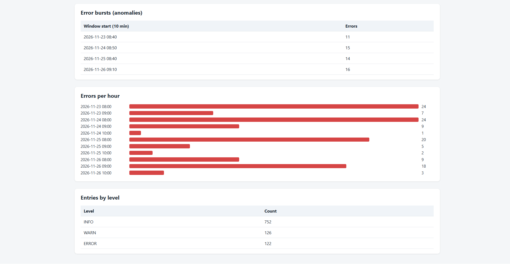
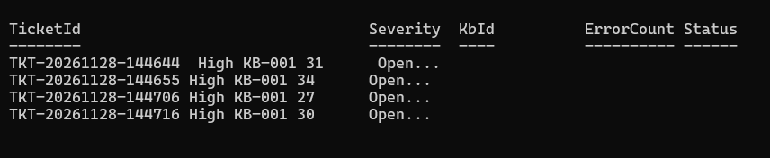
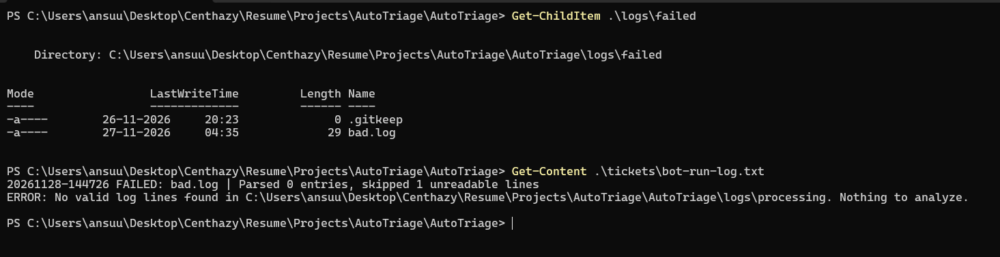
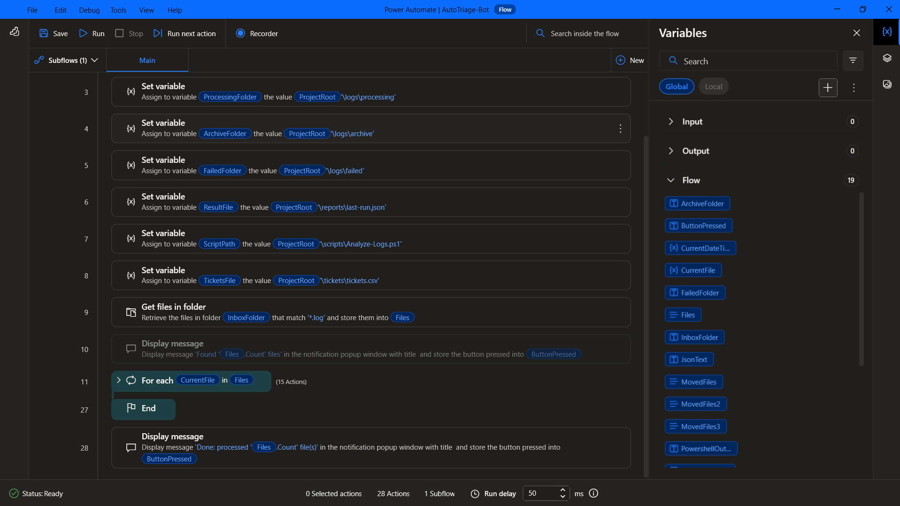
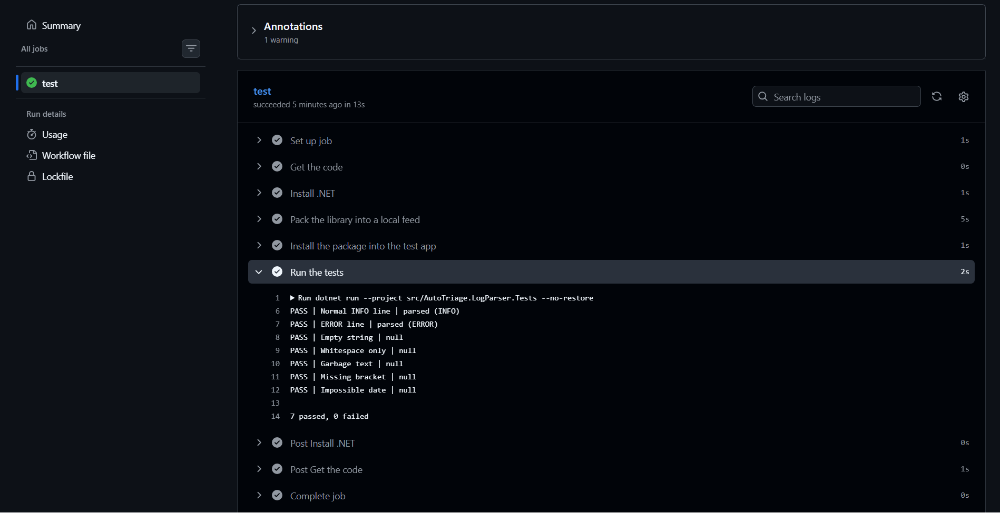

# AutoTriage

!\[Tests](https://github.com/Anasooya-22/AutoTriage/actions/workflows/test.yml/badge.svg)

Automated log analysis and incident reporting toolkit. It reads application logs, groups errors by pattern and severity, flags error bursts, suggests fixes from a troubleshooting knowledge base, produces an HTML report, and logs a mock support ticket. An RPA workflow runs the whole process on every new log file.

> Built as a learning project for automation, log analysis, and incident troubleshooting. All logs are generated sample data.

## What it does

1. **Analyzer (PowerShell):** parses log lines with a regex, counts entries by level and source, ranks the top errors, and flags unusually busy 10-minute windows.
2. **Knowledge base (JSON):** maps each known error pattern to a probable cause, troubleshooting steps, and a resolution.
3. **HTML report:** summary cards, top errors with suggested fixes, error bursts, and errors per hour.
4. **RPA workflow (Power Automate Desktop):** picks up each log from an inbox folder, runs the analyzer, appends a ticket row to a CSV, and archives the log. Files that cannot be analyzed go to a `failed` folder and are recorded in a run log.
5. **LogParser NuGet package (C#):** a small library that parses one log line into a structured entry. Tested with edge cases and built and tested automatically with GitHub Actions.

## Screenshots

### HTML report



### Tickets created by the bot


### Failure handling: a bad log is quarantined, not ticketed


### Power Automate Desktop flow


### CI: tests passing on GitHub Actions



How it works

```
logs/inbox  ->  bot moves file to logs/processing  ->  Analyze-Logs.ps1
     |                                                   |
     |                                    reports/report-<time>.html + reports/last-run.json
     |                                                   |
     +--> success: ticket row added to tickets/tickets.csv, log moved to logs/archive
     +--> failure: log moved to logs/failed, reason added to tickets/bot-run-log.txt
```

## Folder structure

|Folder|Purpose|
|-|-|
|`scripts/`|`New-SampleLogs.ps1` (generates test logs), `Analyze-Logs.ps1` (analyzer and report)|
|`kb/`|`knowledge-base.json`|
|`logs/`|`inbox`, `processing`, `archive`, `failed`|
|`reports/`|Generated HTML reports and `last-run.json` (not tracked in Git)|
|`tickets/`|`tickets.csv` and `bot-run-log.txt` (not tracked in Git)|
|`src/`|`AutoTriage.LogParser` (library) and `AutoTriage.LogParser.Tests` (test app)|
|`docs/`|SOP, runbook, coding standards, test matrix, lessons learned, daily log|
|`.github/workflows/`|CI workflow that packs the library and runs the tests|

## How to run

See [docs/SOP-run-autotriage.md](docs/SOP-run-autotriage.md).

Quick start (Windows PowerShell, from the project root):

```
.\\scripts\\New-SampleLogs.ps1
.\\scripts\\Analyze-Logs.ps1
```

## Testing

The LogParser package has seven edge-case tests (see [docs/nuget-test-matrix.md](docs/nuget-test-matrix.md)). Version 1.0.0 failed one of them (an impossible date caused an exception), which was fixed in 1.0.1. The tests run in GitHub Actions on every push.

## Known limitations

* The anomaly check uses fixed 10-minute windows, so a burst that straddles a boundary can be under-counted. A sliding window and a median-based threshold would be more robust.
* The knowledge base is matched with simple text patterns, so a renamed error message needs a new entry.
* The analyzer still casts timestamps with `\[datetime]`, which could throw on an impossible date. The NuGet package already handles this with `TryParse`.
* The RPA flow does not call the NuGet package. They are separate components.
* The RPA flow is started manually in Power Automate Desktop. It is not scheduled.
* The package is published to a local folder feed, not to nuget.org.
* Built and tested on Windows PowerShell 5.1. Tests for the package run on GitHub Actions because Windows Smart App Control blocks unsigned local builds on the development machine.
- The analyzer reads every `.log` file in the processing folder, so a leftover file from an interrupted run can inflate the results. A safer design would pass a single file path to the script.

## Documentation

* [SOP: running AutoTriage](docs/SOP-run-autotriage.md)
* [RPA workflow](docs/rpa-workflow.md)
* [Troubleshooting runbook](docs/troubleshooting-runbook.md)
* [Coding standards](docs/coding-standards.md)
* [NuGet test matrix](docs/nuget-test-matrix.md)
* [Lessons learned](docs/lessons-learned.md)
* [Daily log](docs/daily-log.md)

